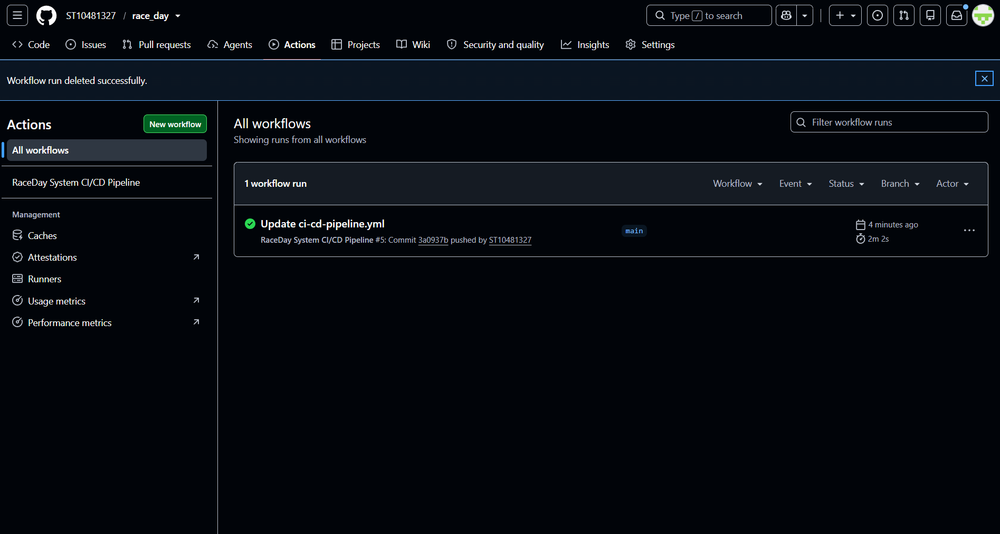

# race_day
# 🏁 RaceDay System (`part1_poe`)

A full-stack event management and participant enrolment platform designed for athletic races (runs, marathons, and fun runs). This repository contains the complete relational database schema, seed data, API specifications, and an automated GitHub Actions CI/CD pipeline.

---

## 📌 Project Overview

The **RaceDay System** provides a centralized system to manage race categories, organize events, process participant enrolments, and track race results.

### Key Features
* **User & Role Management:** Role-based access control supporting `Admin`, `Organiser`, and `Participant` users.
* **Event & Category Management:** Public catalog for viewing upcoming events and race categories (e.g., 5K, 10K, Half Marathon, Full Marathon).
* **Enrolment System:** Registration tracking with approval workflows (`Pending`, `Approved`, `Rejected`, `Withdrawn`) and duplicate enrolment constraints.
* **Results Tracking:** Post-race finish time, finishing position, and personal notes tracking linked to individual event enrolments.

---

## 📊 CI/CD Pipeline Status




# RaceDay API - Part 2

## 📖 Project Overview
The **RaceDay API** is the backend backbone of an event management system built for the Part 2 POE. It is a RESTful ASP.NET Core Web API connected to a SQL Server database. The system manages running, walking, and cycling events, allowing Organizers to create and manage events, and Participants to enrol and view their results.

## 👥 The Two Roles
The system enforces strict role-based access control (RBAC) using session management:

1. **Organizer**
   - Can create, update, and delete their own events.
   - Can add categories (e.g., 10km, Senior) to their events.
   - Can view all enrolments for their specific events.
   - Can approve or reject participant enrolments.
   - Can capture finish times and positions for participants.
   - Cannot enrol in events.

2. **Participant**
   - Can view all available events.
   - Can enrol in an event by selecting a specific category.
   - Can withdraw their own enrolment.
   - Can view their own race results.
   - Cannot create or manage events.

## 🛠️ Setup and Run Instructions

### Prerequisites
- Visual Studio 2022 (with ASP.NET and web development workload)
- .NET 8.0 SDK
- SQL Server Management Studio (SSMS) or Azure Data Studio

### 1. Database Setup
1. Open SQL Server Management Studio (SSMS).
2. Connect to your local server (e.g., `(localdb)\MSSQLLocalDB` or `.\SQLEXPRESS`).
3. Open a new query window and paste the SQL script provided in the `/docs` folder.
4. Execute the script. This will create the `race_day` database, tables, and insert seed data.

### 2. Configure the Connection String
Open the backend database files (e.g., `AuthDatabase.cs`, `EventDatabase.cs`) and ensure the `connectionString` matches your local SQL Server instance:
```csharp
string connectionString = @"Data source=(localdb)\MSSQLLocalDB;Initial Catalog=race_day;Integrated Security=True;";
